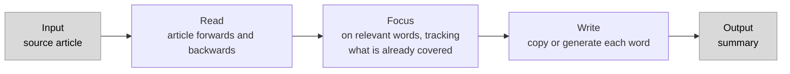
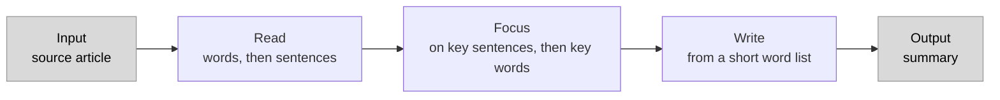
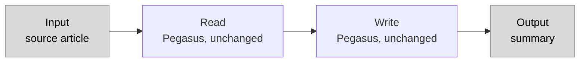
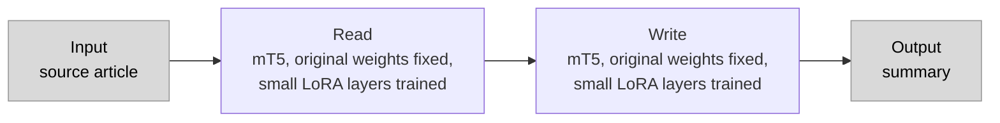
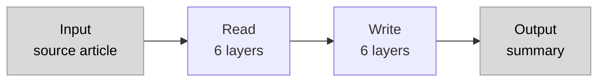

# Comparing Summarization Models on CNN-DailyMail

This project compares five models that summarize news articles in their own words, using the CNN/DailyMail dataset of news stories paired with short human-written summaries. The models fall into two families:

- **Recurrent models**, which read and write text one word at a time, in order: a pointer-generator and a hierarchical-attention model.
- **Transformers**, which look at the whole article at once: one used as Google released it, one further trained on this dataset, and one built and trained from scratch.

Every model is scored with ROUGE (explained under [Results](#results)), but not always on the same articles or with the same scoring tool, so comparisons between models are a guide rather than exact.

On the reported numbers, the pointer-generator scores best on ROUGE-1 and ROUGE-2, while Pegasus, the transformer used as released, is close behind and best on ROUGE-L.

This was a course project for CMP639 Advanced Natural Language Processing, Cairo University. The paper (PDF) is in `paper/`.

## Structure

```
Comparing-Summarization-Models-on-CNN-DailyMail/
├── paper/
│   └── paper.pdf                           # full write-up (methods, results, refs)
└── models/
    ├── recurrent/                          # Recurrent (one package, both models)
    │   ├── configs/                        # base.yaml (pointer-generator), hieratt.yaml
    │   ├── scripts/                        # build_vocab, train, eval, train_hieratt, eval_hieratt
    │   ├── src/
    │   │   ├── data/ utils/
    │   │   └── model/                       # pgn.py (pointer-generator), hieratt.py (hierarchical attention)
    │   └── artifacts/vocab.json             # shared word list (committed)
    └── transformer/                        # Transformer
        ├── from_scratch/                    # trained from scratch
        │   └── vanilla_transformer.ipynb
        └── pretrained_seq2seq/              # mT5 and Pegasus (one package)
            ├── configs/                     # Mt5.json, Pegasus.json
            ├── models/                      # base_model, model_factory, mt5, pegasus
            ├── training/ inference/ evaluation/ preprocessing/
            └── outputs/                     # mt5_eval_111.json, pegasus_eval_111.json, sample_summaries.md
```

## Models

Text lengths below are counted in *tokens*: words and punctuation marks for the recurrent models, and word pieces for the transformers.

### Recurrent

Both recurrent models download CNN/DailyMail (version 3.0.0) from Hugging Face (`abisee/cnn_dailymail`). They share one word list: the 50,000 most common words in the training articles, lowercased, keeping only words that appear at least twice. The list is already saved as `artifacts/vocab.json`, so you don't need to build it. Rebuilding it replaces that file:

```bash
cd models/recurrent
pip install -r requirements.txt     # shared by Pointer-Generator and Hierarchical Attention
python -m scripts.build_vocab       # optional: rebuilds artifacts/vocab.json
```

Both models write summaries with *beam search*: at each step they keep the few most promising partial summaries (4 by default) instead of only the single best next word. The number kept is set by `beam_size` in each model's config file; setting it to 1 means always picking the single best word.

#### Pointer-Generator

At each step, this model either writes a word from its word list or copies one straight from the article, which helps with names and rare words. It also keeps track of which parts of the article it has already used, so it doesn't repeat itself. Articles are cut to their first 600 tokens and summaries to 120. During training it is shown the correct summary one word at a time and penalised for repeating itself.



```bash
cd models/recurrent
pip install -r requirements.txt   # shared with Hierarchical Attention
python -m scripts.train   # config: configs/base.yaml
python -m scripts.eval
```

#### Hierarchical Attention

This model first decides which sentences matter and then which words within them, which suits long news articles where only a few sentences carry the main point. To stay fast, it chooses each summary word from a short list of about 3,000 words rather than the full 50,000. The short list holds the words in the articles and summaries it is currently processing, topped up with common words. Articles are cut to their first 800 tokens and at most 60 sentences, and summaries to 120 tokens.



```bash
cd models/recurrent
pip install -r requirements.txt   # shared with Pointer-Generator
python -m scripts.train_hieratt   # config: configs/hieratt.yaml (fixed random seed 42)
python -m scripts.eval_hieratt
```

### Transformer

The three transformers are ordered by how much training this project does on them: none, then some extra training, then full training from scratch.

#### Used as Released (Pegasus)

Pegasus is Google's summarization model. The version used here, `google/pegasus-cnn_dailymail`, was already trained by Google on this same dataset, and this project runs it unchanged. The paper calls this "zero-shot" (meaning the model never saw this kind of data), but that isn't quite accurate, because this version has already learned from CNN/DailyMail. Articles are read from local data files (default folder `data/raw_data/DailyMail/3.0.0`) and cut to their first 1,024 tokens.



```bash
cd models/transformer/pretrained_seq2seq
pip install -r requirements.txt   # shared with Further Trained (mT5)
# no training step
python -m inference.generate_summaries --config configs/Pegasus.json   # -> outputs/pegasus_predictions.json
python -m evaluation.run_evaluation --config configs/Pegasus.json      # ROUGE: outputs/pegasus_eval_111.json
```

#### Further Trained (mT5 + LoRA)

mT5 is Google's general-purpose multilingual model. Rather than retraining all of it, this project adds small extra layers (a technique called LoRA) and trains only those, which is under 1% of the model. Articles are read from local data files and cut to their first 1,024 tokens, and summaries to 256. When generating summaries, each article starts with the instruction `summarize:`. Training does not add this instruction, even though the config sets it.



`configs/Mt5.json` tells the code to start from previously saved LoRA layers at `checkpoints/mt5_dailymail_2/epoch_1` (the `pretrained_lora_weights` line), but those files are not in the repo. To train from the original mT5, delete that line. To generate summaries with layers you trained yourself, point it at your saved files (training saves them to `checkpoints/mt5_dailymail_3/epoch_<N>`).

```bash
cd models/transformer/pretrained_seq2seq
pip install -r requirements.txt   # shared with Used as Released (Pegasus)
python -m training.train --config configs/Mt5.json
python -m inference.generate_summaries --config configs/Mt5.json   # -> outputs/mt5_dailymail_predictions.json
python -m evaluation.run_evaluation --config configs/Mt5.json      # ROUGE: outputs/mt5_eval_111.json
```

#### Trained from Scratch

This model starts with no prior knowledge and learns only from CNN/DailyMail, so it serves as a baseline. The notebook downloads the dataset from Kaggle and splits text into word pieces using T5's tokenizer (only the tokenizer, none of T5's learned knowledge). Articles are cut to 400 tokens and summaries to 100. Training and scoring both happen inside the notebook.



The notebook was written to run on Kaggle: it uses Kaggle folder paths (`/kaggle/input/...` and `/kaggle/working`), including one for a saved model it resumes training from. Run it on Kaggle, or change those paths to run it on your own machine.

```bash
cd models/transformer/from_scratch
pip install -r requirements.txt               # includes jupyter
jupyter notebook vanilla_transformer.ipynb    # train + evaluate by running all cells
```

## Results

ROUGE measures how much a generated summary overlaps with the human-written one, from 0 to 1 (higher is better). ROUGE-1 counts shared single words, ROUGE-2 shared pairs of consecutive words, and ROUGE-L the longest run of words appearing in the same order in both.

The models were not all scored on the same articles or with the same scoring tool, so the last column says where each row comes from. The *validation set* and *test set* are both groups of articles held back from training.

| Model | ROUGE-1 | ROUGE-2 | ROUGE-L | Source and articles scored |
|---|---|---|---|---|
| Recurrent — Pointer-Generator (best single word) | 0.3668 | 0.1486 | 0.2475 | paper Table 1; validation set, `rouge_score` |
| Recurrent — Pointer-Generator (beam search, 4) | 0.3786 | 0.1629 | 0.2584 | paper Table 1; validation set, `rouge_score` |
| Recurrent — Hierarchical Attention (beam search, 4) | 0.2934 | 0.1087 | 0.2037 | paper Table 1; validation set, `rouge_score` |
| Transformer — Pegasus, used as released (beam search, 5) | 0.3537 | 0.1442 | 0.2613 | [`pegasus_eval_111.json`](models/transformer/pretrained_seq2seq/outputs/pegasus_eval_111.json); first 100 test articles, `rouge_score` |
| Transformer — mT5 + LoRA, further trained (beam search, 5) | 0.2947 | 0.1093 | 0.2118 | [`mt5_eval_111.json`](models/transformer/pretrained_seq2seq/outputs/mt5_eval_111.json); first 100 test articles, `rouge_score` |
| Transformer — Trained from Scratch (best single word) | 0.1983 | 0.0307 | 0.1859 | paper Table 1; notebook scores 50 random test articles with the `rouge` package |

`rouge_score` treats different forms of a word (like "run" and "running") as the same word; the `rouge` package used in the notebook counts differently, so its numbers are not directly comparable. The Pegasus and mT5 rows come from the result files saved in this repo. The paper's Table 1 reports different mT5 scores; this README uses the saved result files.

On these numbers, the small recurrent pointer-generator beats the much larger mT5 on every score, and beats Pegasus on ROUGE-1 and ROUGE-2 while falling just short of it on ROUGE-L.

## License

This project is licensed under the MIT License.

## Contributors

| [<br/>Ahmed Emad](https://github.com/ahmedemad81) | [<br/>Fatema Kotb](https://github.com/FatemaKotb) | Amr Elsheshtawy | Salma Hamed |
|:-:|:-:|:-:|:-:|
