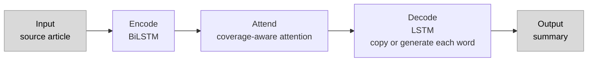
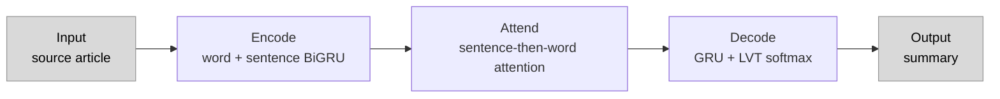
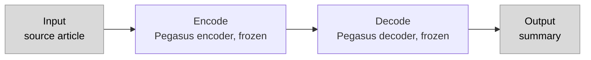
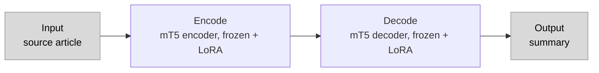
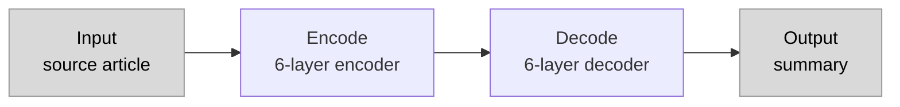

# Comparing Summarization Models on CNN-DailyMail

This project is a controlled comparison of five abstractive summarizers on the CNN/DailyMail benchmark, spanning two families: sequence-to-sequence models (a pointer-generator and a hierarchical-attention model) and transformers (one zero-shot, one fine-tuned, and one trained from scratch). All models are evaluated with the same ROUGE-1/2/L protocol, so score differences reflect modeling choices rather than evaluation setup.

With beam search, the pointer-generator scores highest on ROUGE-1 and ROUGE-2, while the zero-shot transformer is close behind and best on ROUGE-L.

This was a course project for CMP639 Advanced Natural Language Processing, Cairo University. The paper (PDF) is in `paper/`.

## Structure

```
Comparing-Summarization-Models-on-CNN-DailyMail/
├── paper/
│   └── paper.pdf                           # full write-up (methods, results, refs)
└── models/
    ├── recurrent/                          # Sequence-to-Sequence (one package, both models)
    │   ├── configs/                        # base.yaml (pointer-generator), hieratt.yaml
    │   ├── scripts/                        # build_vocab, train, eval, train_hieratt, eval_hieratt
    │   ├── src/
    │   │   ├── data/ utils/
    │   │   └── model/                       # pgn.py (pointer-generator), hieratt.py (hierarchical attention)
    │   └── artifacts/vocab.json             # shared vocabulary
    └── transformer/                        # Transformer
        ├── from_scratch/                    # trained from scratch
        │   └── vanilla_transformer.ipynb
        └── pretrained_seq2seq/              # fine-tuned and zero-shot (one package)
            ├── configs/                     # Mt5.json (fine-tuned), Pegasus.json (zero-shot)
            ├── models/                      # base_model, model_factory, mt5, pegasus
            ├── training/ inference/ evaluation/ preprocessing/
            └── outputs/                     # mt5_eval_111.json, pegasus_eval_111.json, sample_summaries.md
```

## Setup

The code targets Python 3.10+. Each model folder ships its own pinned `requirements.txt` because their dependency footprints differ, so install from inside the folder you want to run:

```bash
cd models/<model-folder>
pip install -r requirements.txt
```

Datasets, checkpoints, and run logs are git-ignored. Each model loads CNN/DailyMail in its own way, with its config file and any committed results noted in its section below.

## Models

### Sequence-to-Sequence

Both recurrent models read CNN/DailyMail 3.0.0 from HuggingFace (`abisee/cnn_dailymail`) and share a 50k vocabulary built from the training split (lowercased, minimum frequency 2). Build it once before running either model; the decoding strategy is set in the config.

```bash
cd models/recurrent
python -m scripts.build_vocab
```

#### Pointer-Generator

The copy path helps reproduce names and rare words taken straight from the article, and the coverage signal discourages the model from repeating itself. Source articles are truncated to 600 tokens and summaries to 120, and it is trained with teacher forcing on NLL plus a coverage loss.



```bash
cd models/recurrent
python -m scripts.train   # config: configs/base.yaml
python -m scripts.eval
```

#### Hierarchical Attention

Attending to sentences before words suits long news articles where only a few sentences carry the summary, and the local vocabulary table (LVT) restricts the decoder's softmax to a small per-example candidate set. Source articles are truncated to 800 tokens and split into at most 60 sentences, with summaries capped at 120 tokens.



```bash
cd models/recurrent
python -m scripts.train_hieratt   # config: configs/hieratt.yaml (sets seed 42)
python -m scripts.eval_hieratt
```

### Transformer

The three transformers are ordered by how much task-specific training they receive: zero-shot, then fine-tuned, then trained from scratch.

#### Zero Shot

Pegasus is a transformer pre-trained specifically for abstractive summarization, and this checkpoint was pre-trained on CNN/DailyMail itself, which makes it a strong baseline. Articles are read from local parquet files (default `data/raw_data/DailyMail/3.0.0`) and truncated to 1024 tokens with the Pegasus tokenizer.



```bash
cd models/transformer/pretrained_seq2seq
# zero-shot — no training step
python -m evaluation.run_evaluation --config configs/Pegasus.json   # ROUGE: outputs/pegasus_eval_111.json
```

#### Fine Tuned

mT5 is a multilingual text-to-text transformer, adapted here with rank-8 LoRA adapters on the attention projections so that under 1% of its parameters are updated. Articles are read from local parquet files, prefixed with `summarize:`, and tokenized to 1024 input and 256 output tokens.



```bash
cd models/transformer/pretrained_seq2seq
python -m training.train --config configs/Mt5.json
python -m evaluation.run_evaluation --config configs/Mt5.json   # ROUGE: outputs/mt5_eval_111.json
```

#### Trained from Scratch

Built and trained from scratch with no pre-training, this model serves as a baseline. The notebook pulls the CNN/DailyMail CSVs from Kaggle, tokenizes them with the t5-base tokenizer, and truncates articles to 400 tokens and summaries to 100. Both training and evaluation run inside the notebook rather than from the command line.



```bash
cd models/transformer/from_scratch
jupyter notebook vanilla_transformer.ipynb   # train + evaluate by running all cells
```

## Results

The table below reports validation-set performance on CNN/DailyMail (ROUGE F1), with each model at its best decoding strategy:

| Model | ROUGE-1 | ROUGE-2 | ROUGE-L |
|---|---|---|---|
| Sequence-to-Sequence — Pointer-Generator (greedy) | 0.3668 | 0.1486 | 0.2475 |
| Sequence-to-Sequence — Pointer-Generator (beam-4) | 0.3786 | 0.1629 | 0.2584 |
| Sequence-to-Sequence — Hierarchical Attention | 0.2934 | 0.1087 | 0.2037 |
| Transformer — Zero Shot (beam-4) | 0.3537 | 0.1442 | 0.2613 |
| Transformer — Fine Tuned (beam-4) | 0.2947 | 0.1093 | 0.2118 |
| Transformer — Trained from Scratch (greedy) | 0.1983 | 0.0307 | 0.1859 |

A compact sequence-to-sequence model matches or beats the much larger pretrained transformers here. Scores come from the committed evaluation outputs, which override the paper's Table 1 where they differ (the fine-tuned row).

This project is licensed under the MIT License.

## Contributors

| [<br/>Ahmed Emad](https://github.com/ahmedemad81) | [<br/>Fatema Kotb](https://github.com/FatemaKotb) | Amr Elsheshtawy | Salma Hamed |
|:-:|:-:|:-:|:-:|