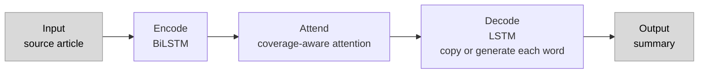
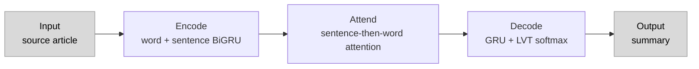
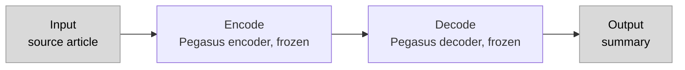
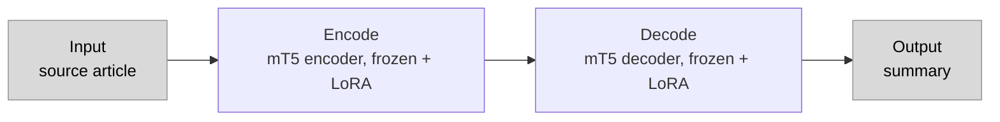
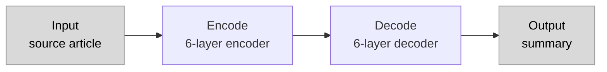

# Comparing Summarization Models on CNN-DailyMail

This project compares five abstractive summarizers on the CNN/DailyMail benchmark, spanning two families: recurrent models (a pointer-generator and a hierarchical-attention model) and transformers (one used off the shelf, one fine-tuned, and one trained from scratch). Every model is scored with ROUGE-1/2/L, but the evaluation sets and ROUGE implementations are not identical across models (see [Results](#results)), so cross-family comparisons are indicative rather than exact.

On the reported numbers, the beam-search pointer-generator scores highest on ROUGE-1 and ROUGE-2, while the off-the-shelf Pegasus transformer is close behind and best on ROUGE-L.

This was a course project for CMP639 Advanced Natural Language Processing, Cairo University. The paper (PDF) is in `paper/`.

## Structure

```
Comparing-Summarization-Models-on-CNN-DailyMail/
├── paper/
│   └── paper.pdf                           # full write-up (methods, results, refs)
└── models/
    ├── recurrent/                          # Recurrent (one package, both models)
    │   ├── configs/                        # base.yaml (pointer-generator), hieratt.yaml
    │   ├── scripts/                        # build_vocab, train, eval, train_hieratt, eval_hieratt
    │   ├── src/
    │   │   ├── data/ utils/
    │   │   └── model/                       # pgn.py (pointer-generator), hieratt.py (hierarchical attention)
    │   └── artifacts/vocab.json             # shared vocabulary (committed)
    └── transformer/                        # Transformer
        ├── from_scratch/                    # trained from scratch
        │   └── vanilla_transformer.ipynb
        └── pretrained_seq2seq/              # fine-tuned and off-the-shelf (one package)
            ├── configs/                     # Mt5.json (fine-tuned), Pegasus.json (off-the-shelf)
            ├── models/                      # base_model, model_factory, mt5, pegasus
            ├── training/ inference/ evaluation/ preprocessing/
            └── outputs/                     # mt5_eval_111.json, pegasus_eval_111.json, sample_summaries.md
```

## Setup

There are three `requirements.txt` files, one per code folder, because their dependency footprints differ: `models/recurrent/` (both recurrent models), `models/transformer/pretrained_seq2seq/` (Pegasus and mT5), and `models/transformer/from_scratch/`. Install from inside the folder you want to run:

```bash
cd models/<folder>   # recurrent, transformer/pretrained_seq2seq, or transformer/from_scratch
pip install -r requirements.txt
```

Only `pretrained_seq2seq/requirements.txt` pins exact versions (developed on Python 3.11.9); the `recurrent/` and `from_scratch/` files list unpinned package names. The recurrent package targets Python 3.10+.

Datasets, checkpoints, and run logs are git-ignored. Each model loads CNN/DailyMail in its own way, with its config file and any committed results noted in its section below.

## Models

### Recurrent

Both recurrent models read CNN/DailyMail 3.0.0 from HuggingFace (`abisee/cnn_dailymail`) and share a 50k vocabulary built from the training split (lowercased, minimum frequency 2). The vocabulary is committed as `artifacts/vocab.json`, so no build step is needed; rebuilding it overwrites that file:

```bash
cd models/recurrent
python -m scripts.build_vocab   # optional: regenerates artifacts/vocab.json
```

Evaluation decodes with beam search; the beam width (`beam_size`, where 1 is effectively greedy) and length penalty are set in each model's config.

#### Pointer-Generator

The copy path helps reproduce names and rare words taken straight from the article, and the coverage signal discourages the model from repeating itself. Source articles are truncated to 600 tokens and summaries to 120, and it is trained with teacher forcing on NLL plus a coverage loss.



```bash
cd models/recurrent
python -m scripts.train   # config: configs/base.yaml
python -m scripts.eval
```

#### Hierarchical Attention

Attending to sentences before words suits long news articles where only a few sentences carry the summary, and the local vocabulary table (LVT) restricts the decoder's softmax to a small candidate set built per batch: special tokens, the batch's own source and target tokens, then frequent words from a common pool up to `lvt_k`. Source articles are truncated to 800 tokens and split into at most 60 sentences, with summaries capped at 120 tokens.



```bash
cd models/recurrent
python -m scripts.train_hieratt   # config: configs/hieratt.yaml (sets seed 42)
python -m scripts.eval_hieratt
```

### Transformer

The three transformers are ordered by how much training this project performs on them: none (off the shelf), then fine-tuning, then training from scratch.

#### Off-the-Shelf (Pegasus)

Pegasus is a transformer pre-trained for abstractive summarization. The checkpoint used, `google/pegasus-cnn_dailymail`, has already been fine-tuned by Google on CNN/DailyMail, and this project runs it as-is with no further training. The paper calls this setting "zero-shot", but because the checkpoint was fine-tuned on this dataset it is an in-domain baseline rather than a true zero-shot one. Articles are read from local parquet files (default `data/raw_data/DailyMail/3.0.0`) and truncated to 1024 tokens with the Pegasus tokenizer.



```bash
cd models/transformer/pretrained_seq2seq
# no training step
python -m inference.generate_summaries --config configs/Pegasus.json   # -> outputs/pegasus_predictions.json
python -m evaluation.run_evaluation --config configs/Pegasus.json      # ROUGE: outputs/pegasus_eval_111.json
```

#### Fine-Tuned (mT5 + LoRA)

mT5 is a multilingual text-to-text transformer, adapted here with rank-8 LoRA adapters on the attention projections so that under 1% of its parameters are updated. Articles are read from local parquet files and tokenized to 1024 input and 256 output tokens. At inference, each article is prefixed with `summarize:`; the training collator accepts the same prefix but does not apply it, so training inputs are unprefixed.



`configs/Mt5.json` sets `pretrained_lora_weights` to `checkpoints/mt5_dailymail_2/epoch_1`, which is not in the repo. To train from base mT5, delete that line. To generate summaries with adapters you trained, point it at your checkpoint (training writes `checkpoints/mt5_dailymail_3/epoch_<N>`).

```bash
cd models/transformer/pretrained_seq2seq
python -m training.train --config configs/Mt5.json
python -m inference.generate_summaries --config configs/Mt5.json   # -> outputs/mt5_dailymail_predictions.json
python -m evaluation.run_evaluation --config configs/Mt5.json      # ROUGE: outputs/mt5_eval_111.json
```

#### Trained from Scratch

Built and trained from scratch with no pre-training, this model serves as a baseline. The notebook pulls the CNN/DailyMail CSVs from Kaggle, tokenizes them with the t5-base tokenizer, and truncates articles to 400 tokens and summaries to 100. Both training and evaluation run inside the notebook rather than from the command line.



The notebook was written for Kaggle: it reads and writes hardcoded `/kaggle/input/...` and `/kaggle/working` paths, including a checkpoint it resumes from. Run it on Kaggle, or edit those paths before running it locally.

```bash
cd models/transformer/from_scratch
pip install -r requirements.txt               # includes jupyter
jupyter notebook vanilla_transformer.ipynb    # train + evaluate by running all cells
```

## Results

ROUGE F1 on CNN/DailyMail. The models were not all scored on the same examples or with the same ROUGE library, so the last column gives each row's source and evaluation set:

| Model | ROUGE-1 | ROUGE-2 | ROUGE-L | Source and evaluation set |
|---|---|---|---|---|
| Recurrent — Pointer-Generator (greedy) | 0.3668 | 0.1486 | 0.2475 | paper Table 1; validation split, `rouge_score` |
| Recurrent — Pointer-Generator (beam-4) | 0.3786 | 0.1629 | 0.2584 | paper Table 1; validation split, `rouge_score` |
| Recurrent — Hierarchical Attention (beam-4) | 0.2934 | 0.1087 | 0.2037 | paper Table 1; validation split, `rouge_score` |
| Transformer — Off-the-Shelf Pegasus (beam-5) | 0.3537 | 0.1442 | 0.2613 | [`pegasus_eval_111.json`](models/transformer/pretrained_seq2seq/outputs/pegasus_eval_111.json); first 100 test articles, `rouge_score` |
| Transformer — Fine-Tuned mT5 + LoRA (beam-5) | 0.2947 | 0.1093 | 0.2118 | [`mt5_eval_111.json`](models/transformer/pretrained_seq2seq/outputs/mt5_eval_111.json); first 100 test articles, `rouge_score` |
| Transformer — Trained from Scratch (greedy) | 0.1983 | 0.0307 | 0.1859 | paper Table 1; notebook scores 50 random test articles with the `rouge` package |

`rouge_score` is run with stemming; the `rouge` package used in the notebook is a different implementation and does not give identical numbers. The two pretrained transformer rows are taken from the committed evaluation outputs. The mT5 row differs from the paper's Table 1, which reports different mT5 scores; this README uses the committed outputs.

On these numbers, a compact recurrent model beats the much larger fine-tuned mT5 on every metric and the off-the-shelf Pegasus on ROUGE-1 and ROUGE-2, falling just short of Pegasus on ROUGE-L.

## License

This project is licensed under the MIT License.

## Contributors

| [<br/>Ahmed Emad](https://github.com/ahmedemad81) | [<br/>Fatema Kotb](https://github.com/FatemaKotb) | Amr Elsheshtawy | Salma Hamed |
|:-:|:-:|:-:|:-:|
